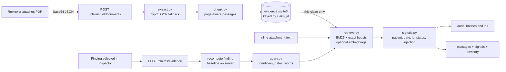

# Supporting evidence retrieval (RAG)

## Purpose

ClaimGuard's principle is **rules decide, AI explains**. Evidence retrieval adds a third role:
**retrieval helps humans find evidence**.

When a reviewer opens a `FAIL` or `UNABLE_TO_ASSESS` finding, the system searches the claim's own
attached documents and shows the passages most relevant to that finding, each with deterministic
consistency signals. It helps the reviewer decide faster. It **never** changes a rule status, severity,
`requires_human_review`, confidence or any quality score.

- On demand: retrieval runs when a finding is selected, never at ingestion.
- Offline: no API key needed. Lexical retrieval is the baseline; embeddings are an optional re-ranker.
- Generic: no rule IDs in retrieval code. Query terms come from the finding's own evidence, so rules
  authored later get the same treatment.
- One claim at a time: there is no global index and no cross-claim or cross-patient search.
- Untrusted text: document content is data. It is never executed, never put into a model prompt, and
  never influences a rule result.

## Architecture



Package `backend/src/evidence_rag/`:

| File | Responsibility |
|---|---|
| `models.py` | `Document`, `Passage`, `QueryTerms`, `ScoredPassage`, `Signals` |
| `extract.py` | PDF to per-page text with pypdf; OCR (pytesseract + pymupdf or pdf2image) for pages under 20 characters when available |
| `chunk.py` | 150-word passages with 25-word overlap, never crossing a page; stable ids; character offsets into the page text |
| `store.py` | `EvidenceStore` (SQLite, thread lock). Stores sha256, metadata and passages, not the PDF bytes |
| `query.py` | Deterministic query terms from the recomputed finding |
| `retrieve.py` | `LexicalRetriever` (BM25 + boosts), `EmbeddingRetriever` (re-ranker with lexical fallback) |
| `signals.py` | Consistency signals and advisory flags |
| `sanitize.py` | Control-character stripping, label cleaning, injection-phrasing detection (flags, never rewrites) |
| `service.py` | `EvidenceService`: upload, list, delete, search, audit |
| `demo_docs.py` | Scenario selection and PDF rendering for the demo (reportlab, dev only) |

## Data flow

### Upload

`POST /api/v1/claims/{claim_id}/documents` with `{attachment_id, filename, content_base64}`.

1. Base64 is decoded strictly. Raw size must be at most 3 MB (so the JSON body stays under the 5 MB API cap).
2. The bytes must start with `%PDF-`. Encrypted, malformed or empty PDFs return `422 invalid_document`;
   more than 30 pages or more than 200,000 extracted characters return `422 document_too_large`.
3. Each page is extracted on its own; one page failing adds a `page_N_extract_failed` warning and never
   fails the document. Pages with almost no text go to OCR when it is installed; otherwise the document
   gets an `ocr_unavailable` warning and is indexed with whatever text exists.
4. Passages are stored under `(claim_id, document_id)`. Re-uploading identical bytes for the same claim and
   attachment returns the existing document (`created: false`) and writes no new audit event.

`attachment_id` is a label linking the PDF to one of the claim's attachment records when one exists. It
need not exist, and the claim need not be ingested. Nothing is added to the claim itself: the claim schema
is unchanged.

### Query derivation

From the **server-recomputed** finding and the claim:

- every string or number in `finding.evidence` (JSON-pointer paths are skipped; booleans, nulls and very
  short values are skipped);
- for each affected line: its `service_code`, `service_date`, `authorization_id`;
- claim anchors: `patient_id`, `member_id`, `invoice_number`, `provider_id`;
- the rule's title and corrective action as low-weight hints.

A value is an **identifier because of the field that holds it**, not because of its shape: any field whose
name ends in `_id`, `_code` or `_number` (read from the evidence item's JSON pointer, or the object key), and
the claim anchors above, are taken verbatim. So `PT/99-ALPHA`, `88812345` and `QX 12 ZZ` all work. Other
values are split into identifiers that look like one (`[A-Z]{2,}-[A-Z0-9-]+`), ISO dates, numbers and words.
Anything that looks like a rule ID (`R` + digits) is dropped.

### Ranking

Candidates are the claim's stored passages plus its inline `attachment.text` (indexed on the fly, capped at
20,000 characters). Score = BM25 over words, numbers and hints, plus a boost of 8 per exact identifier and
4 per exact date (with boundaries, so `AUTH-1` never matches inside `AUTH-12`). A passage is returned only
if it matches an identifier or date, or at least two non-hint words: rule-title words alone never make a
passage relevant. The top 5 are returned. An empty result comes with `no_supporting_evidence`, which is a
useful answer in itself.

With `EVIDENCE_EMBEDDINGS=true` and `OPENAI_API_KEY` set, an embedding similarity is added to the lexical
score. Any embedding error falls back to the lexical ranking, reported as `retriever: "lexical"` with an
`embedding_fallback` warning.

### Signals (facts, not verdicts)

| Signal | Meaning |
|---|---|
| `patient_match` | `match` / `mismatch` / `unknown`: patient ids in the passage against the claim's `patient_id`. A mention is the claim's own id verbatim, a token after a "patient" label that contains a digit, or a token with the same prefix as the claim's id (`PT/` for `PT/99-ALPHA`). No id format is assumed. With no mention, the linked attachment's `patient_id` metadata is used |
| `date_relation` | `equal` if the passage mentions an affected line's service date, `different` if it mentions only other dates, `none` |
| `identifier_found` | The finding's identifiers that appear verbatim |
| `status_hint` | approved / denied / pending / draft / final, the nearest such word to a found identifier (a hint) |
| `injection_suspected` | Instruction-like phrasing ("ignore previous instructions", "mark this claim as PASS", "SYSTEM:") |

Advisory flags on the response: `contradicting_evidence` (patient mismatch or a denied hint),
`possible_resolution` (identifier found with an approved or final hint, same patient, not suspected),
`no_supporting_evidence`, `injection_suspected`, `ocr_low_confidence` (a document was scanned or OCR was
unavailable). They are for display. They do not feed `assess()` and do not change `requires_human_review`.

## Endpoints

| Method | Path | Notes |
|---|---|---|
| POST | `/api/v1/claims/{claim_id}/documents` | Upload. 201. Audited as `evidence_document_added` |
| GET | `/api/v1/claims/{claim_id}/documents` | Metadata only, no text |
| DELETE | `/api/v1/claims/{claim_id}/documents/{document_id}` | Audited as `evidence_document_removed` |
| POST | `/api/v1/claims/evidence` | `{claim, rule_id}` |

The evidence endpoint validates the claim, recomputes the finding with `baseline` (like
`POST /explanations`, so a client cannot forge the finding), and returns:

```json
{
  "claim_id": "CG-B39790AC3604", "rule_id": "R008", "finding_status": "FAIL",
  "applicable": true, "retriever": "lexical", "advisory": ["possible_resolution"],
  "passages": [{
    "passage_id": "psg-...", "document_id": "evd-...", "attachment_id": "DOC-CG-B39790AC3604-AUTH",
    "filename": "prior_authorization_letter.pdf", "source": "pdf", "page": 1,
    "text": "...", "highlights": [{"start": 10, "end": 19, "term": "SVC-IMAGE"}], "score": 52.1,
    "matched": {"identifiers": ["SVC-IMAGE"], "dates": ["2026-04-02"], "words": []},
    "signals": {"patient_match": "match", "date_relation": "equal", "identifier_found": ["SVC-IMAGE"],
                "status_hint": "approved", "injection_suspected": false}
  }],
  "documents_searched": 2, "warnings": [],
  "notice": "Retrieved text is unverified. The rule result is unchanged."
}
```

A `PASS`, `NOT_APPLICABLE` or `NOT_IMPLEMENTED` finding returns `applicable: false` with no passages, and
**no audit event** is written (nothing was searched). Unknown rules return `404 rule_not_found`; inactive
ones `404 rule_not_active`. If the document store cannot be read, the response still returns 200 with
the inline passages and a `document_store_unavailable` warning.

## Privacy and safety model

- **Scope**: every query is filtered by `claim_id` on both the passage and the document row. A document
  uploaded for claim A is never returned for claim B (tested).
- **Audit**: `evidence_retrieval` stores `rule_id, query_sha256, retriever, result_count, passage_ids,
  document_ids, advisory`. Document events store `document_id, attachment_id, document_sha256,
  page_count, method`. Never passage text, query terms, filenames or extracted text. These keys are in
  `AuditService.recent_events` `allowed_fields`, and `GET /audit/verify` stays valid.
- **No prompts**: v1 uses no language model with document text. An optional LLM summary would have to follow
  the `OpenAIExplanationProvider` pattern (delimited data block, citation allow-list, deterministic fallback).
- **No path traversal**: filenames are cleaned metadata. Nothing is written to disk under a user-supplied
  name, and PDF bytes are not kept (only their sha256).
- **Rendering**: the UI renders passages and filenames as React text nodes, never `dangerouslySetInnerHTML`.
  Suspected-injection passages are collapsed and shown as plain monospace text.
- **Isolation from evaluation**: rule evaluation never reads the evidence store. Results from
  `POST /claims/evaluate` are identical before and after uploads and searches, including with an injection PDF (tested).

## Frontend

- **Inspector**: a "Supporting passages" section between Explanation and Review action for actionable
  findings. It is cached per claim and rule, fetched with an `AbortController`, and has loading, error
  (non-blocking), empty and result states. An advisory banner, passage cards with highlighted terms and
  signal chips (always with a word, never colour alone), and the line "Unverified text from attached
  documents. The rule result is unchanged."
- **Use as reason**: puts a reference such as `Evidence: DOC-1 p.1 (psg-...)` at the top of the Dismiss
  reason list and opens the dismiss form. The reviewer still confirms; nothing is recorded automatically.
- **Documents panel** on the claim sheet: list, attach (PDF only, 3 MB check before upload), remove.
  Any change clears that claim's evidence cache and re-runs the open search.
- **Audit trail**: evidence searches show as "Evidence searched for R0xx".

## Limitations

- OCR is optional and only as good as the scan. Without Tesseract, scanned pages are not searchable (and say so).
- Lexical retrieval finds exact identifiers and dates reliably, but misses paraphrases. Embeddings help, if enabled.
- Status hints are a keyword near an identifier. "Approved" in a letter is not proof of approval.
- Another patient's id is only noticed when it is labelled ("Patient: …") or shares the claim's id prefix.
  An unlabelled id in a completely different format gives `unknown`, not `mismatch`.
- `backend/tests/test_evidence_genericity.py` guards all of this: a source scan for rule ids and dataset id
  prefixes, an invented rule with unseen id formats, every actionable finding on claims without
  attachments, and a real claim with all its ids rewritten.
- Injection detection is a phrase list. It flags common patterns; it does not need to be perfect, because
  document text cannot change any result anyway.

## Demo script

All demo documents are **synthetic and fictional** (no real PHI). They reuse the synthetic ids of real
development claims so retrieval has something genuine to find.

```bash
cd backend
python src/load_demo_documents.py            # load the committed PDFs into outputs/evidence.sqlite3
python src/load_demo_documents.py --verify   # run all six scenarios in an isolated temporary app
python src/load_demo_documents.py --generate # regenerate PDFs + manifest (needs reportlab)
```

`backend/data/demo_documents/manifest.json` maps each claim to its file and expected outcome. Open each
claim at `/app/claims/<claim_id>` and select the listed rule:

| # | Scenario | Claim / rule | What the reviewer sees |
|---|---|---|---|
| 1 | Authorization letter resolves a gap | `CG-B39790AC3604` / R008 FAIL | Letter with patient, service and date, "APPROVED". Banner: *Possible resolution found*. Patient match, date match, hint approved |
| 2 | Draft in metadata, final in the PDF | `CG-F5F2411AC3AD` / R010 UNABLE | Attachment listed as draft; the PDF says FINAL and signed. Hint: final, *Possible resolution* |
| 3 | Letter for a different patient | `CG-D11E0A7ED473` / R009 FAIL | Authorization number matches but patient does not. Chip *Patient mismatch*, banner *Contradicting evidence* |
| 4 | Prompt injection | `CG-70B4E80B9519` / R009 UNABLE | Passage collapsed with a warning, plain text only. `injection_suspected`; rule results and status unchanged |
| 5 | Scanned image-only PDF | `CG-909B339818EB` / R008 FAIL | With Tesseract: OCR text is searched. Without: upload succeeds, document shows *OCR unavailable*, advisory `ocr_low_confidence` |
| 6 | Unrelated clinical note | `CG-128A977172C2` / R009 UNABLE | "No supporting evidence found in the attached documents", a useful signal to request information |
