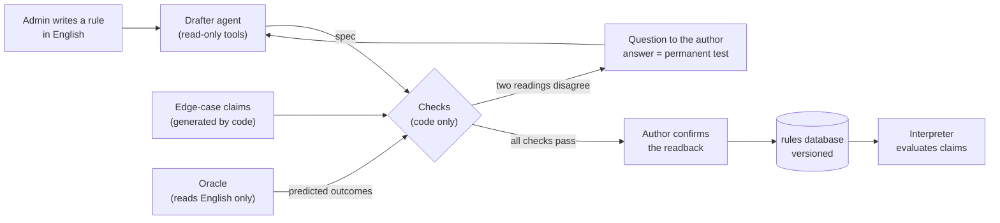

# Rule engine and rule authoring

Rules are **data, not code**. Every active rule is a small JSON spec that the server
evaluates itself. A language model can *propose* a spec for a new rule written in
English, but only plain code decides whether it may run.

For a step-by-step walk-through of what happens to a rule from the moment the admin submits
it, see [RULE_PIPELINE.md](RULE_PIPELINE.md).



## 1. Running rules

| Piece | File | Role |
|---|---|---|
| Rule language | `backend/src/rule_engine/language.py` | Pydantic models: the exact shape of a spec. One definition for checking and evaluating. |
| Static checks | `rule_engine/validation.py` | Fields exist in `claim.schema.json`, names are defined, types fit, limits on size and nesting. |
| Interpreter | `rule_engine/interpreter.py` | Evaluates a spec on one claim with three-valued logic and an operation budget. |
| Readback | `rule_engine/readback.py` | Renders a spec as plain English, with a fixed template (no AI). |
| Spec store | `rule_engine/spec_store.py` | One SQLite database (`outputs/rules.sqlite3`): every revision (append-only), and which one is active. It scales to thousands of rules in a single file. |
| Reference seed | `rules/reference_specs.json` | The 15 reference specs in one reviewable file, loaded into the database automatically. |
| Runtime | `rule_engine/engine_core.py` | `config()` loads the active specs and `baseline()` runs them. One failing rule gives `UNABLE_TO_ASSESS`, never an error. |

The full language reference, with examples, is
[`backend/src/rule_authoring/prompts/rule_language.md`](../backend/src/rule_authoring/prompts/rule_language.md).
The drafting model is given the same text, so the documentation and the model's
instructions cannot drift apart.

### Safety properties

- **No code is generated or executed.** A spec is parsed into fixed Pydantic models.
  Paths cannot index arrays and there is no null literal; there is no `eval`, no regex
  and no file access.
- **Specs are bound to their text.** Each stored spec records the SHA-256 of the
  English logic it implements. If `rules.json` is edited by hand, the rule stops
  running (it becomes inactive) rather than running old logic.
- **Specs are re-checked on every load.** A corrupted or hand-edited stored spec that
  fails the checks is inactive, with the reason reported by `GET /api/v1/rules`.
- **History cannot be rewritten.** Database triggers forbid `UPDATE` and `DELETE` on
  stored revisions. Deactivating only removes the "active" pointer.
- **Reference specs come from the seed file.** A rule with no history gets the seed as
  revision 1. When the seed changes, reference rules get a new revision, but a rule an
  admin has revised or deactivated is left alone.
- **Drafted rules live only in the database.** `rules.json` lists them, but their specs
  are in `outputs/rules.sqlite3`. If that file is lost, those rules become inactive
  (they fail safe) until they are re-drafted, so back the file up with the audit log.
- **Bounded evaluation.** There is a 200,000-operation budget per rule and claim,
  and decimal arithmetic where overflow becomes "unknown".
- **Missing is never PASS.** A condition that needs a missing or invalid value is
  unknown, which gives `UNABLE_TO_ASSESS` and a human review. A claim value is missing
  when it is absent, `null` or blank text. A value the rule writes itself is never
  missing, even `""`: `{"first_present": [modifier, ""]}` is the rule's own default
  (R006: "normalize null modifier to an empty string").
- **One format for every path.** `validate_transport` checks each claim against
  `schemas/claim.schema.json` (every field's type, no NaN or Infinity, dates as
  `YYYY-MM-DD`), as the API does on upload, so the batch pipeline and the app accept the
  same claims. A fractional quantity is valid input (the schema says `number`); R013 is
  what fails it. The engine reads dates only as `YYYY-MM-DD`, like the schema.
- **One audit chain, any number of writers.** Before each write, the audit logger takes
  a lock shared across processes and chains onto the entry that is really last in the
  file. So the app and a script (or two app workers) can never fork the chain
  (`tests/test_audit_chain.py`).

## 2. The reference rules R001–R015

R001–R015 were rewritten as specs by hand (`origin: "reference"`) and proven against
the original Python rules:

- **9,000 / 9,000** expected outcomes reproduced (development, validation and stress
  splits; `tests/test_reference_specs.py`).
- The same status as the original Python rules on **3,000 seeded mutated claims**
  (45,000 rule checks covering missing values, boundary dates and amounts, unknown
  codes and duplicates).

**Two intentional differences**, neither of which occurs in any official claim, so all
9,000 expected outcomes are unchanged:

- **R009.** When two authorization records share the same id **and disagree** (one approved
  and one denied, two different maximum quantities), the original code silently used the
  last one. The reference spec returns `UNABLE_TO_ASSESS` so that a human resolves the
  ambiguity. An **identical copy** is the same record (decided with the product owner,
  2026-10-12): the text says nothing about duplicates, and a copy changes nothing R009 checks
  (the quantities it adds up are the lines', and the limit is the same in both copies). It
  used to give `UNABLE_TO_ASSESS` too, and that was R009's first correction in two benchmark
  runs: a draft right on all 400 development claims was then derailed chasing it. A rule
  sheet cannot say "the copies agree", so R009's sheet uses the first copy; the two differ
  only on claims where copies disagree, which no official claim and no generated test claim
  has (`tests/test_rule_sheet.py` leaves them out).
- **R013** (decided with the product owner, 2026-10-12). The rule says "a known violation
  fails". A quantity that is not a positive whole number, a unit price that is not positive,
  or a quantity or price above a known policy limit now **fails**, whatever else is missing.
  The original code returned `UNABLE_TO_ASSESS` as soon as the policy, the service or any
  value of the line was unknown, before looking at the rest. That was a shortcut in the
  code, not the rule. Each check now reads only what it needs: the limits need the policy and
  the service, the positivity checks nothing else.

The original Python is kept in `rule_engine/legacy_rules.py` as a **reference only**:
it is used by the tests above and is not on the runtime path.

### Replacing them with AI-drafted rules

The hand-written specs are the yardstick. The goal is to run the rules the drafter
writes from the rulebook's English text, exactly as for an admin's new rule:

```bash
cd backend
python src/regenerate_official_rules.py --model nvidia/nemotron-3-super-120b-a12b   # backend server stopped
python src/score_drafted_rules.py --drafts      # official F1 of the drafts, before confirming
```

The first command submits each rule's text from `rules/rules.json`, unchanged, as a
revision. By default (`--answers rulebook`), the drafter's questions and the test-claim
table are answered as an admin who knows the rulebook would: the outcome the verified
implementation gives. With `--answers panel`, they are left to an admin. Nothing is
activated: each draft waits for confirmation in the admin panel. A confirmed draft keeps
the rule's identity (`fictional-rulebook/R001@1.0.0`), so `run_baseline.py` and the
official scorer then run the AI-drafted rule. `rules/rules.json` and the rule database
are backed up to `outputs/backups/` first.

**The gate.** An official rule's draft replaces the hand-written rule only when it is
nearly as good on the official data (`rule_benchmark/official.py`):

- the decision uses the **development claims** (400): issue F1 ≥ 0.95 (a FAIL is an issue,
  as `evaluate.py` counts it) **and** status agreement ≥ 98%. Both are needed: F1 counts
  FAIL only, so a draft can have F1 1.0 and still decide other claims wrongly; and a draft
  can agree on 98% of the claims while missing 8 of the 36 violations (an R001 without
  the invoice number check: 392/400, F1 0.875);
- when no development claim should FAIL, F1 says nothing and agreement alone decides;
- the score on **validation and stress** (200 claims), which the decision never sees, is
  reported beside it: the honest estimate of how the deployed draft does on new claims.

`regenerate_official_rules.py` prints each waiting draft's verdict after drafting, and
`--confirm --rules R001,R002` confirms only the drafts that clear the gate (`--min-f1` and
`--min-agreement` set the bars). A draft below it stays waiting with its numbers; the rule
keeps running its hand-written version. Each verdict, with its numbers, is written to the
audit log (`official_rule_gate`). The benchmark reports the same verdict per rule
(`gate`) and the drafts that clear it (`deployable`, with their held-out score).

The gate needs known outcomes, so it applies to the 15 official rules only. A new rule
from an admin has none: its draft is judged by the checks and the admin's review.

## 3. Authoring a rule

An admin writes a rule in English. The AI drafts an implementation in the rule
language; code checks it; the admin checks what it decides on concrete test claims and
corrects any outcome; the rule goes live only when the admin confirms. Every
correction becomes a permanent test that the rule must reproduce.

| Piece | File | Role |
|---|---|---|
| Drafter | `backend/src/rule_authoring/drafter.py` | Agent loop. Each turn the model sends one JSON action: `check`, `try`, `ask_author`, `propose` or `unsupported`. |
| Worked examples | `rule_authoring/examples.py` | The 3 active rules whose English is closest to the new one, with their working specs. |
| Edge cases | `rule_authoring/edge_cases.py` | Test claims generated by code from the fields and values that the draft reads: missing, null, just below / at / just above each number, boundary dates. |
| Checks | `rule_authoring/checks.py` | The gates listed below, with the readback and an impact preview. |
| Oracle (optional) | `rule_authoring/oracle.py` | A second model that predicts outcomes from the English text only. Off by default. |
| Workflow | `rule_authoring/service.py`, `drafts.py` | The draft state machine, corrections, questions, activation and audit. |
| API | `backend/src/api_app/rule_routes.py` | `/api/v1/rules`, described below. |
| UI | `frontend/src/components/RuleManager.tsx` | Admin Panel, "Validation Rules" tab. |

### What the drafter receives and can do

The rule text (as quoted data), the claim field catalogue, the names of the reference
data, the language reference, and **the 3 most similar active rules with their working
specs**. Small models copy a close worked example far more reliably than they apply a
manual, and every rule that goes live becomes an example for the next one. Similarity
is plain word overlap; a rule is never shown its own spec.

Its tools only read: they check a spec, or run it on generated test claims. It cannot
write files, activate a rule, choose a rule id or see the dataset. Budgets per session:
14 turns, 5 malformed replies and 8 minutes.

It may ask the author **at most 2 questions per rule**, and each must come with 2 to 4
answer options that are complete on their own ("Yes: a total of exactly 10000 passes").
The admin picks an option or answers in their own words; a bare "yes" or "no" is
accepted only when it clearly names one option. Questions about boundaries and missing
data are discouraged, because the admin checks those cases directly (below).

### The checks (all code)

1. **fields_and_types**: every field exists and every comparison has fitting types.
2. **author_examples**: every outcome the author confirmed or corrected is reproduced exactly.
3. **not_constant**: the outcome varies across cases; a rule that cannot change is
   almost certainly misread.
4. **dataset_dry_run**: the spec runs on all development claims without errors.
5. **independent_reading** (only if the oracle is switched on): the spec agrees with the
   oracle on the generated cases.

A draft that fails a code check goes back to the drafter with the problems, up to 6
rounds since the admin last answered or corrected, and is rejected if it still fails.
Each correction is a new task for the drafter, so it starts a fresh count. Nothing that
fails a code check can be confirmed.

### Checking the outcomes

A draft that passes the code checks waits for the admin with:

- the **plain-English readback**, generated from the implementation (not from the AI);
- the **impact** on the development claims;
- the **case table**: what the rule decides on each generated test claim;
- **notes** that never block:
  - values the rule's text names that the draft never uses ("MEM-"), a sign that part of
    the rule may have been left out;
  - a draft that fails more than half the development claims, which is usually stricter
    than the rule intends (for example "member id equals MEM-" for "starts with MEM-").

The test claims are built by code, so the cases that expose a wrong draft are always there:

- every field the draft reads is pushed to its edges (missing, blank, around every
  number and date the rule uses, known and unknown codes, lists of the sizes the rule counts);
- every field the rule's **text** names is probed too, even when the draft never reads it,
  so a draft that silently drops part of the rule shows a wrong outcome;
- a few claims combine a **missing value with a violation**, which is the only way to see
  whether "a known violation wins over missing data" was respected;
- each field's test claims are **diverse, not numerous**. A rule reading 20 fields gets
  about 2 claims per field within the limit of 40, so each one has to count:
  - "blank" is left out where "missing" is tried, because the engine reads them alike;
  - the first kind (usually "missing") goes on **two** claims, because the same change
    means different things in different places (R010 was wrong only on a lab line);
  - then each claim tries a **kind not yet tried** for that field, on the claim used least
    (an unknown code exposed R009, a negative quantity R013).

  Across the 29 wrong proposals of earlier benchmark runs, at the same 40 claims, this
  exposes **29**. Taking turns with each kind in order exposed 25, and so did 60 claims in
  that order.

Every case records the **field** it changes (`field` in the case table). The benchmark's
simulated admin corrects **one field at a time**: only the first field with a wrong
outcome. The drafter fixes that before the next field is looked at, so it gets one clear
thing to fix instead of every mistake at once. On the 27 wrong proposals from earlier
benchmark runs, the case table now exposes 25 (it exposed 22 before). The 2 it misses are
a R013 case that never occurs in the official data.

**Right outcomes are kept, not only corrections.** Before, only corrections became tests:
an outcome the admin had checked and found right was recorded nowhere, so the next draft
could change it unnoticed. On 2026-10-12, R009 fixed the one field it was corrected on and
turned 15 right outcomes (a wrong patient, an expired or unapproved authorization: FAIL)
into UNABLE_TO_ASSESS. Now a verdict equal to the draft's outcome **confirms** it, and the
confirmed outcome is a test like any other:

- the simulated admin confirms every outcome it checked on the way to the field it
  corrects (the fields before it in the table, and that field's right rows);
- the drafter sees them apart from the corrections, as `author_confirmed` (outcomes to
  keep, not to change), and `try` lists any its draft changes in `author_confirmed_changed`;
- a draft that changes one is refused like a draft that ignores a correction;
- a verdict repeating an existing test leaves it as it was, so a correction confirmed
  again later stays a correction.

The admin panel still sends only the rows the admin changed; letting the admin confirm
the rows they reviewed belongs with the planned case-table work (one field at a time).

### Warnings before confirming a revision, and escalation

**Warnings.** A revision of an existing rule is measured on the development claims before
the admin confirms it, and any difference becomes a note under "Worth a look". Notes warn,
they never block. The measures are in `report.comparison`:

- against **the rule running today**: the number of claims decided differently, with examples;
- against **the known correct outcomes**, when the dataset has them and the rule's text is
  unchanged (the challenge's 15 rules): agreement, and issue F1 computed as the official
  scorer does.

Agreement is the warning that matters. F1 counts only FAIL as an issue, so it misses other
mistakes. The 98.3% R010 draft had **F1 1.0** but decided 6 of 400 claims wrongly ("unable to
assess" where the answer was "not applicable"); it is flagged by agreement, not by F1. A new
rule has neither a current version nor known outcomes: its test claims are its review.

**Escalation.** `POST /api/v1/rules/drafts/{id}/escalate` hands a rule that could not be
generated (rejected, or stuck waiting for example claims) to a technical manager. It records
who escalated and when, on the draft and in the audit log (`rule_draft_escalated`). It
returns a pre-filled email (to, subject, body, `mailto:`) for the admin's own mail app,
addressed to `CLAIMGUARD_TECH_CONTACT_EMAIL`; nothing is sent by ClaimGuard. The email holds
the rule, why drafting stopped and the number of attempts, never claim data. Everything else
stays in ClaimGuard under the draft id.

### Questions on missing data

Drafts that pass every check are most often wrong on what missing or unknown data gives. On
2026-10-12 every error R009 made was one: an unknown service code gave NOT_APPLICABLE instead
of UNABLE_TO_ASSESS (the sentence "unknown service … leaves UNABLE_TO_ASSESS" was never
implemented in five drafts), and a line without its authorization_id gave FAIL. R010's last
draft required a date on lines it did not apply to. In the test-claim table, corrected one
field at a time, each of those takes a drafting round.

So when a draft first passes the checks, and before the table, the admin is asked a few
questions, one per **situation** (`rule_authoring/missing_data.py`). Plain code groups the
draft's test claims that make a value missing or unknown:

1. a value that decides whether the rule applies (an `applies_if` / `only_if` reads it) is
   missing or unknown: one question, whatever else the claim holds;
2. a value the rule checks is missing, or is a code the reference files do not have, on a
   claim the draft applies to, per list (the claim, a line, a record in authorizations);
3. the same on a claim the draft does not otherwise apply to;
4. a whole list is empty.

"Unknown" means a code missing from the reference files (a service code not in services.json,
a policy not in policies.json, ...). Each question shows an example claim and what the draft
gives; the admin picks one outcome, or "It depends". One outcome becomes a test for every claim
of the situation (a confirmed outcome when the draft already gives it), and the situation in
words goes to the drafter as an answer ("when a value that decides whether the rule applies is
missing or unknown: UNABLE_TO_ASSESS"). "It depends" adds nothing: those claims stay in the
table. A situation is asked once per draft; at most 10 questions per draft.

On the hand-written rules, every situation with a single answer already matches them, so the
questions never push a right rule anywhere (`tests/test_missing_data.py`). Rules ask 1 to 6. A
record of another list missing a field is usually "it depends": the record's id missing means
there is no record (FAIL), another field missing UNABLE_TO_ASSESS. The simulated admin answers
from the reference: one outcome when the reference decides every claim of the situation alike,
otherwise "it depends".

**A situation the rule text already answers is not asked.** When the draft's sheet quotes the
text's own sentence in its `outcomes` table (below) and the draft gives that outcome on every
test claim of the situation, the question is skipped and recorded instead (draft event
"decided by the rule text", and `provenance.decided_by_text` with the quotes). Only for one
value missing or unknown on the claim or a line, of a claim the draft does not otherwise fail;
records of other lists, empty lists, claims the rule does not apply to and "a violation plus a
missing value" are still asked. A draft that does not follow its own table is asked as before.
On the 15 official rules written with their texts' tables, 21 of their 51 questions are
answered by the text, and every one agrees with the hand-written rule
(`DecidedByTheTextTests`).

### Example claims from the admin

A client admin cannot write code, but can say "this claim should fail". Example claims are
claims with the outcome the admin expects. They become permanent examples the rule must
reproduce, the same mechanism as corrections. The drafter sees their content, with free
text hidden.

- **Optional when submitting:** `examples` on `POST /api/v1/rules/drafts`, up to 10.
- **Offered when drafting stops** (`RULE_OFFER_EXAMPLE_CLAIMS=true`; off by default until
  the admin panel has a form for them): "give example claims, then draft again" is one of
  the admin's choices (see "Never losing a good draft"). It opens an `example` question,
  answered by `POST /api/v1/rules/drafts/{id}/examples`, and drafting starts again.
- **In the benchmark and the official regeneration,** the simulated admin gives
  **development claims only**, with the outcomes the draft has no example of first. Those
  rules must then be scored on the splits the drafter never saw:
  `score_drafted_rules.py --splits validation,stress`.

A correction finds its claim by regenerating the cases. If the generator has changed
since the table was shown, the same case id can name another claim. So the correction is
refused (409 `cases_changed`), and the draft has to be drafted again.

All 34 correct reference rules pass every check with no notes, and a test keeps it that
way: a check that blocks a correct rule would make that kind of rule impossible to add.

The admin changes any outcome that is wrong and sends the corrections. Each one is stored
as a permanent test for the rule, and the draft goes back to the drafter, which must
reproduce every one of them (the code refuses a proposal that does not). When the
outcomes are right, the admin confirms and the rule goes live.

### The optional second reading

`RULE_INDEPENDENT_READING` controls the oracle:

| Value | Effect |
|---|---|
| `off` (default) | No second model. The admin's check of the case table is the review, so confirmation is always required. Half the model calls, so drafting is faster. |
| `advice` | The oracle's disagreements are flagged in the case table ("worth a look"); the admin decides. |
| `block` | Disagreements become questions to the admin, and a draft is rejected if they remain after 6 questions or the oracle is unavailable or too unstable. |

On a small model the oracle was right on only about half the cases, so it is off by
default: the admin is the ground truth, and every answer they give becomes a test.

### A committee of drafts (`RULE_COMMITTEE_SIZE`)

A small model drafting the same rule twice can produce two different rules, and nothing
in a single draft shows it is the wrong one. With `RULE_COMMITTEE_SIZE=3`, the rule is
drafted three times independently, at different sampling temperatures, and plain code
compares the drafts:

- every draft runs on the same generated test claims;
- drafts that decide every claim alike count as one candidate rule;
- if there are several candidates, the admin is asked about the claims that tell them
  apart: "for a claim where …, should the rule PASS, FAIL, be UNABLE_TO_ASSESS or
  NOT_APPLICABLE?" Claims that split the drafts evenly are asked first, and never two
  questions that separate them the same way;
- each answer becomes a permanent example, drafts that contradict it are dropped, and the
  surviving rule goes through the usual checks without drafting again;
- past the question budget, the largest group of agreeing drafts is kept.

This is "query by committee" from active learning: questions go where the model is
uncertain, so a few answers settle the rule. When all drafts agree, nothing is asked.

A drafting session that sends the same draft three times is told so. At the fourth time it
stops, keeping its best checked draft.

`RULE_EXAMPLE_SOURCE` is `catalogue` by default. The benchmark's `--examples none` hides
the catalogue rules, which measures the drafter alone, with no hand-written answer
nearby.

### Missing and unknown data written on the condition (`if_missing`, `if_unknown`)

Rule texts say what missing data and unknown codes give ("missing values leave
UNABLE_TO_ASSESS", "unknown service codes leave UNABLE_TO_ASSESS", "a known violation
fails"). Until 2026-10-12 a sheet could only say it by **where** a condition sat: the sheet's
`needs` (before applies_if, on every line), `applies_if`, a check, `where` (a record with a
missing field does not match) or `then`. Nearly every error the hard rules made that day was a
condition in the wrong place: a line's authorization_id or date put in `needs`, so lines the
rule does not apply to became UNABLE_TO_ASSESS; checks moved between `where` and `then`; the
unknown-code test put in `applies_if`, where an unknown code simply does not match. The model
itself kept writing `"otherwise": "UNABLE_TO_ASSESS"` next to the condition.

So a condition can now say it, next to itself (an idea of the product owner):

| key | when | in applies_if | in a check |
|---|---|---|---|
| `if_missing` | a value it reads is missing | UNABLE_TO_ASSESS (default) or NOT_APPLICABLE | UNABLE_TO_ASSESS (default) or FAIL |
| `if_unknown` | a value it reads is unknown: missing, or a code not in the reference files (service, provider, diagnosis, policy) | UNABLE_TO_ASSESS or NOT_APPLICABLE | UNABLE_TO_ASSESS or FAIL |

`if_unknown` covers missing values too because rule texts use "unknown" for both ("unknown
service/policy/date leaves UNABLE_TO_ASSESS"): in collection run 2, R010 put `if_unknown` on
a date, was refused, and fell back to `needs`. With both keys, `if_missing` decides missing
values and `if_unknown` codes the files do not list.

The compiler turns each into a step tested just before the condition: a need
(UNABLE_TO_ASSESS), an only_if (NOT_APPLICABLE) or a require (FAIL) that the value is present
or the code known; the engine is unchanged. On a has_match, `if_missing` covers the values of
the line or claim being checked that the search uses; a field missing on the record itself is
checked in `then`. Defaults are the old behaviour, so every existing sheet is unchanged.

**Proof:** R008, R009 and R010 written with these keys and no `needs` at all give exactly the
outcome of the hand-written rules on every benchmark claim (`tests/test_rule_sheet.py`,
`OutcomeKeysTests`); a key in the wrong place gets a message saying where it goes.

### The rule text's own sentences (`outcomes`)

The keys still had to be written on the right conditions, one by one, and a sentence such as
"unknown service codes leave UNABLE_TO_ASSESS" concerns several of them. Rule texts state these
outcomes almost word for word, so the sheet now carries them once, quoted:

```json
{"outcomes": {"unknown_code": {"outcome": "UNABLE_TO_ASSESS",
                               "quote": "a line whose service code is unknown cannot be assessed"}},
 "checks": [...]}
```

| entry | when | outcome |
|---|---|---|
| `missing_in_checks` | a value a check reads is missing | UNABLE_TO_ASSESS (default) or FAIL |
| `missing_in_applies_if` | a value an applies_if condition reads is missing | UNABLE_TO_ASSESS (default) or NOT_APPLICABLE |
| `unknown_code` | a service, provider or diagnosis code not in the reference files (or missing, unless a `missing_in_` entry says otherwise) | UNABLE_TO_ASSESS, FAIL (checks), NOT_APPLICABLE (applies_if) |
| `unknown_policy` | the claim's policy is not in policies.json | as `unknown_code` |

- **Code writes the outcome onto every condition** that reads such a value directly and says
  nothing itself (`sheet.py`, `outcome_guards`): the same guard steps as the keys. A
  condition's own `if_missing` / `if_unknown` replace the table for it. Left alone: `present`
  and `missing` (a missing value is what they test), a list's fields read all at once
  (`unique`), and the checks on a record found (`then`). A guard that only repeats the default
  (a missing value in a plain check is already UNABLE_TO_ASSESS) is not written.
- **Each quote is checked by code** against the rule's title and logic (`outcome_quote_problems`):
  the words must be in the text (`...` may skip words, at least three words), speak of what the
  entry is about (an unavailable policy is not an unknown code) and say the outcome. Otherwise
  the drafter gets a problem back and the entry is not used. An outcome the text does not say
  stays the drafter's guess, for the admin to review.
- The table lives in the sheet, so it travels with the draft: the last draft, the good drafts,
  the confirmed rule shown as an example later.

**Proof:** every official rule written as only its comparisons (no `needs`, no keys) plus a
table quoting its own text gives exactly the hand-written rule's outcome on every benchmark
claim; without the table R008, R009 and R010 are wrong on 39, 73 and 89 of them
(`OutcomeTableTests`). So a drafter only has to write the comparisons and copy sentences, and
the part the hard rules kept getting wrong is done by code.

### Never losing a good draft, never keeping the admin waiting

- **Auto-propose** (`RULE_AUTO_PROPOSE`, default on): a sheet that passes the drafter's checks
  and gives every outcome the admin confirmed is proposed on the turn it is checked. In
  collection run 2 a quarter of all model time re-sent a good sheet to `try` and `propose`, and
  changing a sheet after seeing its own test results was the commonest step before a draft got
  worse. A sheet that failed the full checks last round is not proposed again by itself.
- **Good drafts are kept:** every draft that passes the checks is kept (`Draft.good_drafts`,
  up to 5), so a later, worse draft cannot lose it.
- **A time limit** (`RULE_MAX_DRAFTING_MINUTES`, default 10) counts from the admin's last input;
  a drafting session never runs past it.
- **The admin chooses** when drafting stops (time limit, the drafter stuck, the provider
  failing): a `choice` question offers "use draft k" (it agrees with N of your M outcomes; the
  others are dropped, audited as `rule_draft_chosen`), "keep drafting for up to 10 more
  minutes", "give example claims, then draft again" (with `RULE_OFFER_EXAMPLE_CLAIMS`), or
  "cancel". Nothing good is thrown away without the admin deciding. A chosen draft goes to the admin's review as it is, without new
  missing-data questions (`Draft.chosen`; a new draft, a correction or examples clear it).

**Measured (2026-10-12, `outputs/speed1_*`, Nemotron 3 Super, the same settings as collection
runs 2 and 3), on the five slowest official rules:**

| rule | before | now | first deployable draft | model calls |
|---|---|---|---|---|
| R003 | 953 s | 12 s | 12 s | 1 |
| R006 | 2037 s | 271 s | 271 s | 5 |
| R009 | 693 s | 609 s | 69 s | 11 |
| R010 | 1466 s | 652 s | 652 s | 2 (over 5 minutes each, at the provider) |
| R013 | 2422 s | 20 s | 20 s | 1 |

Every one correct and deployable, 100% on the development and held-out claims; 7571 s in all
became 1563 s. R009's time after minute 1 is the simulated admin correcting test claims about
authorization records (not in the official data).

### The rule sheet (`RULE_DRAFTING_FORMAT=sheet`)

Writing a full spec (a nested program of steps) is the hardest part for a small model,
so the drafter can write a **rule sheet** instead (`src/rule_authoring/sheet.py`), a short
flat list that plain code compiles into the spec:

```json
{"applies_if": [{"value": "/lines/*/service_code", "is": "equals", "to": "SVC-PHARM"}],
 "checks": [{"value": "/lines/*/quantity", "is": "between", "to": [1, 10]}]}
```

- **checks** are what the rule requires: a broken check is a FAIL, and missing data is
  UNABLE_TO_ASSESS (except `present`, which fails when the value is missing).
- **applies_if** limits the rule to some claims or lines (NOT_APPLICABLE otherwise).
- **needs** are values (or conditions) without which the rule cannot be assessed at all.
  A check can have its own `needs`, tested only for the claims or lines the rule applies to.
- **has_match** finds a matching record in another list. With `then`, it looks up one
  referenced record (a line's authorization, for example) and checks each of its fields
  separately: a missing field is UNABLE_TO_ASSESS, a known mismatch is a FAIL.
- **otherwise** turns an unmet check into UNABLE_TO_ASSESS instead of FAIL. `sum`, `count`,
  `latest` and `earliest` take a `where` filter.
- **group_by** on `sum` or `count` totals only the elements that share this element's value
  of a field: `{"sum": "/lines/*/quantity", "group_by": "authorization_id"}` is, for each line,
  the quantity of the lines on that line's authorization. It makes the check run for each line,
  and a line without the key is UNABLE_TO_ASSESS: its group is unknown, not empty. It compiles
  to a `where` filter, so the engine is unchanged, and R009 written with it equals the
  reference on every claim (`tests/test_rule_sheet.py`). It exists because the drafter gave up
  on R009 and INV-20 asking for exactly this: "a sum grouped by a key".
- **Values** are fields written as in the field list (`/lines/*/quantity` runs the check
  for every line), fixed values, policy and catalogue values, and `count`, `sum`,
  `latest`, `earliest`, `days_between` and arithmetic.

**What the compiler does instead of the model:**
- It writes the loops and names their variables, so wildcard paths and reused names
  cannot go wrong.
- It turns every check into its own step, so a known violation always wins over
  missing data.

**Proof and fallback:**
- Hand-written sheets for 34 of the 35 benchmark rules, including all 15 challenge rules,
  compile to rules that give exactly the reference outcome on every benchmark claim; a
  test keeps it so (`tests/test_rule_sheet.py`). These sheets are test fixtures. When the
  catalogue is used for examples, they are also shown to the drafter as similar rules, so
  honest measurements use `--examples none`.
- What a sheet cannot express goes to the full language as before. INV-07 ("starts with
  MEM-") needs text patterns, which neither has.
- A compiled sheet is checked and reviewed like any other spec.

In sheet mode the drafter is shown the proven sheets of similar catalogue rules as
examples (`src/rule_authoring/reference_sheets.json`). The default is still `spec` until
the benchmark has compared the two.

### Working with a small, free model

The pipeline is built to run on a small model (by default the free
`llama-3.2-11b-vision-instruct` on NVIDIA's endpoint). A weaker model never weakens
safety: everything it produces goes through the same checks and the admin's review.
What it changes is how often a draft succeeds. These measures help a small model:

- **Near-JSON is repaired**: prose or code fences around the reply, missing closing
  brackets (including a list left open before the next key), trailing commas, comments,
  single or curly quotes, unquoted keys, Python literals and a forgotten `"spec":` key.
  A reply that still cannot be read goes back with the parser's error and position.
- **"Every line" written as a wildcard** (`/lines/*/service_date`) is rewritten into the
  `for_each` the language expects. Other invalid paths get a plain explanation of how to
  write one. The rewritten spec is checked exactly like any other.
- **Values written the wrong way** are rewritten when they have one clear meaning:
  - a `let` value read back as `{"total"}` or `{"value": {"total"}}` becomes `{"path": "$total"}`;
  - arithmetic written like a condition (`{"op": "multiply", "items": [a, b]}`) or beside
    its value (`{"path": a, "multiply": [b]}`) becomes `{"multiply": [a, b]}`;
  - an object written without braces inside a list (`["path": "$x"]`) gets its braces;
  - a `note` or `otherwise` placed inside the condition moves up to its step.

  Where the meaning is unclear, the error message says what to write instead: a value used
  as a condition, a date compared with a number of days, or a `let` value read the wrong way.
  A test keeps all 34 correct reference specs untouched by these repairs.
- **Disagreements come with what to change.** When a spec contradicts an outcome the author
  confirmed, the drafter is told why in the language's terms. For example: "a known
  violation must win over missing data: check each bound in its own require; within_dates
  is unknown as soon as one date is missing".
  - The hint uses the words of the format the drafter writes. A sheet drafter told about
    "only_if steps" switches to the full language to follow the advice, and does worse there.
  - "Should be NOT_APPLICABLE, is UNABLE_TO_ASSESS" names the usual cause: a need tested
    before applies_if. Moving it into the check's own needs fixes it.
- **Giving up is challenged when the rule was already written.** Once a draft of the rule
  has passed every check, a later "unsupported" is sent back once, with the constructs that
  are easy to miss (`then`, `where`, `group_by`, `first_present`, a check's own needs). If the
  drafter insists, the draft counts as stuck, and the admin is asked for example claims. A
  rule no draft has written yet (INV-07) is not challenged this way.
- **Giving up over the author's examples is refused once**, with those hints repeated.
- **A session that runs out keeps its best spec.** When turns, time or readable replies run
  out, or the API fails, the latest spec that passed every check and reproduces every author
  example is proposed. It goes through the same checks and the admin's review, with a note
  that drafting stopped early.
- **Unreadable replies are kept with the draft** (the last three), so format slips can be
  diagnosed without running the model again.
- **Giving up early is refused once**: an `unsupported` before any spec was tried is sent
  back with "write the closest spec you can".
- **Worked examples** from the catalogue, and **one complete example reply** in the prompt.
- `intent` and `assumptions` placed inside the spec are moved next to it.

### Draft states

`queued → drafting → checking → awaiting_confirmation → active`. A question leads to
`awaiting_author`, then back to `queued` once answered; a correction leads back to
`queued`. Any open draft can end as `rejected` or `cancelled`. A draft that was running
when the server stopped is rejected on restart.

### Activation

- The audit event is written **before** the rule takes effect. If the audit log is
  unavailable, the rule is not activated.
- The spec is re-checked against the current files right before activation.
- Rule ids are assigned by the server (`R` + digits, no upper limit) and never
  reused, not even after deletion or rejection.
- The rule is live immediately, with no restart. The kill switch is
  `POST /api/v1/rules/{id}/deactivate`.
- Rules added this way run in the app. `src/run_baseline.py` writes only the challenge
  rulebook R001–R015 (what the official scorer accepts) unless `--all-rules` is given.

## 4. API

| Method | Path | Admin token | Purpose |
|---|---|---|---|
| GET | `/api/v1/rules` | no | Catalogue with status (active / inactive and why) |
| GET | `/api/v1/rules/{id}` | no | Rule, active spec, readback, history |
| POST | `/api/v1/rules/drafts` | yes | Submit `{title, severity, logic, corrective_action, rule_id?}` (202, drafted in the background) |
| GET | `/api/v1/rules/drafts`, `/drafts/{draft_id}` | yes | Drafts and their reports |
| POST | `/api/v1/rules/drafts/{draft_id}/answers` | yes | `{question_id, answer}` |
| POST | `/api/v1/rules/drafts/{draft_id}/corrections` | yes | `{corrections: [{case_id, expected_status}]}`: the admin's outcomes on test claims; any change redrafts |
| POST | `/api/v1/rules/drafts/{draft_id}/confirm` | yes | Activate a draft that passed every code check |
| POST | `/api/v1/rules/drafts/{draft_id}/cancel` | yes | Cancel an open draft |
| POST | `/api/v1/rules/{id}/deactivate` | yes | Kill switch |

`rules.json` can no longer be saved through `/api/v1/config` (409), and every config
save now needs the admin token.

## 5. Configuration

| Variable | Default | Purpose |
|---|---|---|
| `CLAIMGUARD_ADMIN_TOKEN` | unset, so admin changes are **disabled** | Shared token (at least 16 characters) sent as `X-Admin-Token` |
| `CLAIMGUARD_RULES_DB` | `outputs/rules.sqlite3` | Rule spec and draft database |
| `RULE_DRAFTER_MODEL` | `OPENAI_MODEL` | Model for the drafter (should be good at following JSON instructions) |
| `RULE_INDEPENDENT_READING` | `off` | `off`, `advice` or `block` (see "The optional second reading") |
| `RULE_DRAFTING_FORMAT` | `spec` | `spec` (the drafter writes full specs) or `sheet` (rule sheets compiled by code, see "The rule sheet") |
| `RULE_COMMITTEE_SIZE` | `1` | Independent drafts compared per rule (up to 5); where they disagree, the admin is asked (see "A committee of drafts") |
| `RULE_ORACLE_MODEL` | the drafter model | Only used when the second reading is on; preferably a **different** model |
| `RULE_REQUIRE_AUTHOR_CONFIRMATION` | `true` | `false` activates automatically when every check passes, but only when the second reading is on; with it off, confirmation is always required |
| `RULE_DRAFTS_PER_HOUR` | `20` | Rate limit on submitted drafts |
| `RULE_MISSING_DATA_QUESTIONS` | `true` | Ask the admin what missing or unknown data gives, once per situation, before the test-claim table (see "Questions on missing data") |
| `RULE_MAX_DRAFTING_MINUTES` | `10` | Drafting time since the admin's last input before the admin is asked what to do (see "Never losing a good draft") |
| `RULE_AUTO_PROPOSE` | `true` | Propose a sheet as soon as it passes the drafter's checks and gives every confirmed outcome |
| `RULE_OFFER_EXAMPLE_CLAIMS` | `false` | When drafting stops, also offer "give example claims" (the admin panel has no form for them yet; the API does) |

Without `OPENAI_API_KEY`, drafts are rejected and nothing is activated.

## 6. Benchmark

```bash
cd backend
python src/run_rule_benchmark.py --set all --out outputs/rule_benchmark.json             # ~35 rules, 4 at a time
python src/run_rule_benchmark.py --set quick --format sheet --out outputs/quick.json    # 10 rules, a few minutes
```

Rules are drafted 4 at a time (`--workers`, keep within the provider's rate limit), and
every model reply is written next to the report (`*.replies.jsonl`), so a failure can be
studied without running the model again. `--set quick` is ten representative rules.

### Reading a run: what happened, and where our code steered the model

The log (`*.replies.jsonl`, also written by `regenerate_official_rules.py`) holds the whole
story in time order, since 2026-10-12:

- every model call: **what our code sent** just before it (the task, minus the parts that
  never change, or a tool's result: problems, test-claim outcomes) and **what the model
  replied**;
- what the pipeline did: checks passed or failed and why, each question to the admin (with
  the claims a missing-data question covers) and the answer, each correction (the draft's
  outcome and the right one) and the outcomes confirmed, and how the draft ended.

```bash
python src/check_drafting_log.py outputs/hard_v11_R009.replies.jsonl
```

prints a summary (minutes, sessions, questions, corrections, best and last draft scored on
the official development claims), the story session by session (why each session started:
the first draft, the admin's answers or corrections, failed checks) and **warnings**:

- a message of ours repeated 3 times or more while the model kept making the mistake: it
  does not tell the model what to do;
- a draft that got worse right after something we sent, with what we sent.

Each warning names a message, a check or an answer, never a rule, so the fix it calls for
applies to every rule.

Across rules: `python src/check_drafting_log.py outputs/collect1_*.replies.jsonl --patterns`
prints a line per rule (minutes, sessions, calls, best and last draft, how it ended), our
messages ranked by how often they came right before a worse draft or repeated without effect
(particulars like field names are blanked, so one message about many fields counts once),
what came just before each worse draft (a problem message, its own test results, the admin's
answers or corrections) and what the model changed (applies_if, needs, a check added or
removed, conditions moved between then and where). A pattern seen in two rules or more is a
candidate for a general fix.

**`try` shows what an edit changed.** Each `try` lists, under `changed_since`, the test claims
whose outcome differs from the previous try (the first try of a session: from the last draft
it starts from). It says nothing about which outcome is right. Without it, R009 added one
claim-level check that made 172 claims the rule does not apply to PASS, and saw only the new
outcomes, not that they had changed. Three such messages were found and fixed on 2026-10-12: a correction
the rule text does not support (a duplicated record), "use it inside count" for a field
already inside count, and "otherwise is for checks only" for a need that was right.

### Fixes stay general

`tests/test_generality.py` holds the line, on every test run:

1. the drafting code (`rule_authoring/`, `rule_engine/`) never names a rule in code; comments
   and docstrings may cite one as evidence;
2. the drafter's prompts hold no sentence of an official rule and no official answer sheet;
3. for every rule with a known answer (the 15 official, 19 invented), the correct rule goes
   through the whole pipeline untouched: no correction, one drafting session, every official
   outcome right. A fix that steers a right rule away fails here.

What these tests cannot show is that a fix helps on rules nobody looked at: that takes rules
written after the fix (held-out rules), drafted with the real model.

This runs the real pipeline (it **uses model calls**) on the English text of R001–R015
and on 20 invented rules (`src/rule_benchmark/invented_rules.json`), including one rule
the language cannot express. A simulated author who knows the correct behaviour answers
questions and corrects the case table, like a real admin would. Each final proposal is
compared with the reference on the dataset, mutated claims and the boundary cases of
both specs. The key outputs are `correct` (the rule the admin would confirm is exactly
right) and `wrongly_accepted` (a wrong rule reached the confirmation screen with no
correction left to make). Options: `--only R001,INV-10`, `--repeat N`, `--reading
off|advice|block`, `--no-corrections`.
