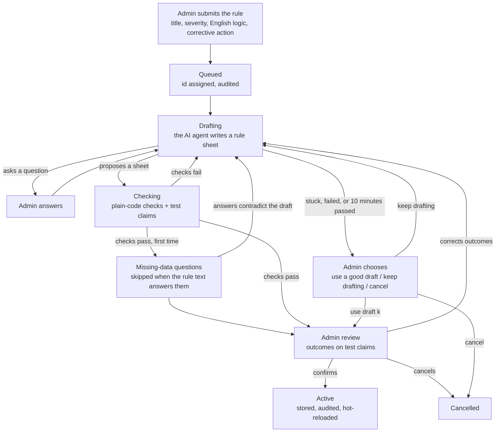

# The rule pipeline: from the admin's English rule to a live rule

The admin writes a payer rule in plain English. An AI agent turns it into a **rule sheet**,
which is data, not code. Plain code checks every draft, and the admin reviews what the rule
decides on test claims. Nothing goes live until the admin confirms it.

The model never writes code and never sees real claims. Every step is recorded in the audit
log.

For the engine, the rule language and the benchmark, see [RULE_ENGINE.md](RULE_ENGINE.md).

## At a glance



| State | Meaning |
|---|---|
| `queued` | submitted, waiting for the background worker |
| `drafting` | the AI agent is writing the rule sheet |
| `checking` | plain code is checking the proposed rule |
| `awaiting_author` | a question for the admin: clarification, missing data, or what to do next |
| `awaiting_confirmation` | every check passed: the admin reviews the outcomes and confirms |
| `active` | live: every claim evaluation runs it |
| `rejected` / `cancelled` | ended; nothing was activated |

## 1. Submission (instant)

The admin fills in the rule in the admin panel:
- title and severity;
- the rule logic in English;
- the corrective action;
- optionally, up to 10 example claims with the outcome each should get.

The panel sends it to `POST /api/v1/rules/drafts`. The server then:

1. **Checks the admin token** (`X-Admin-Token`). Without it, rules cannot be changed.
2. **Enforces the rate limit** (20 drafts per hour) and one open draft per rule.
3. **Assigns the rule id.** A new rule gets the next `R` number. A revision keeps its id, and
   the current version keeps running until the new one is confirmed.
4. **Saves the draft** in the rules database, in state `queued`.
5. **Records `rule_draft_submitted`** in the audit log, with a fingerprint of the text.
6. **Returns at once (202).** Drafting runs in the background, and the panel polls the draft.

## 2. Drafting: the AI agent (`drafting`)

**What the agent receives:**
- the rule text;
- every claim field with its meaning, and a made-up example claim;
- the reference files: policies, services, providers and diagnoses;
- the admin's answers, examples and confirmed outcomes so far;
- its own last draft;
- up to 3 similar rules it drafted before that an admin confirmed.

It never gets the official rules or their expected answers.

**What it writes:** a rule sheet.

```json
{"outcomes": {"unknown_code": {"outcome": "UNABLE_TO_ASSESS",
                               "quote": "a line whose service code is unknown cannot be assessed"}},
 "applies_if": [{"value": "/lines/*/service_code", "is": "one_of", "to": {"policy": "auth_required_services"}}],
 "checks":     [{"value": "/lines/*/authorization_id", "is": "present"}]}
```

- `applies_if`: which claims or lines the rule concerns. When a condition does not hold, the
  result is NOT_APPLICABLE.
- `checks`: what the rule requires. When a check does not hold, the result is FAIL.
- `outcomes`: what the rule text says missing data or an unknown code gives, quoted from the
  text. Code applies each outcome to every condition that reads such a value.

**How a session runs.** The agent replies with one JSON action per turn:
- `check`: compile the sheet and report problems;
- `try`: run the sheet on test claims;
- `ask_author`: send the admin a question;
- `propose`: offer the sheet as finished;
- `unsupported`: say the rule cannot be expressed.

Code does the rest:
- **Repairs format slips** in the model's JSON.
- **Compiles every sheet** and sends back problems with a fix, for example:
  - an unknown field, with the closest real one;
  - a construct in the wrong place;
  - a quote that is not in the rule text;
  - an outcome that applies to nothing.
- **Proposes a good sheet at once.** When a sheet compiles and gives every outcome the admin
  confirmed, it is proposed straight away. Most rules need one model call, about 5 to 35 seconds.

**Limits per session:**
- 14 turns and 5 unreadable replies;
- never past the 10-minute limit;
- the same draft sent 4 times ends the session.

**How a session ends:**
- **with a proposal** → step 3;
- **with a clarifying question** → the admin answers. At most 2 per draft, each with 2 to 4
  ready answers. Then drafting resumes;
- **with no rule** (the agent gave up, failed, or the model was unreachable) → step 6.

## 3. Plain-code checks (`checking`)

Every proposed rule must pass:

1. **Fields and types:** every field exists and every comparison fits its type.
2. **The admin's outcomes:** every example, correction and confirmed answer is reproduced.
3. **Varied outcomes:** a rule that gives the same result on every test claim is almost
   certainly misread. If it is UNABLE_TO_ASSESS everywhere, the message names the value that is
   usually missing.
4. **A dry run on the 400 development claims**, without errors.
5. *(Optional, off by default)* an independent reading by a second model.

The check also builds what the admin will review:
- **About 40 test claims**, made from 3 varied base claims. Each value the rule reads is made
  missing, blank or an unknown code. Numbers are moved just below, at and just above each limit,
  dates are shifted and lists emptied, and some claims combine a missing value with a violation.
- **A readback** of the rule in plain English.
- **An impact preview:** how many development claims would PASS, FAIL and so on.
- **Notes to look at**, for example:
  - a value the text mentions that the rule never uses;
  - a rule that fails most claims;
  - values copied from `policies.json` instead of read from the claim's policy.
- **For a revision,** a comparison with the rule currently running.

If a check fails, the problems go back to the agent, which repairs its last draft (step 2).
This repeats for up to 6 rounds since the admin's last input. Every draft that passes is kept
as a good draft (up to 5), so a later, worse draft can never lose it.

## 4. Questions on missing data (`awaiting_author`)

The first time a draft passes, code groups its test claims into a few situations and asks one
question per situation:
- a value that decides whether the rule applies is missing or unknown;
- a value the rule checks is missing, or a code the reference files do not know, on the
  claim, a line or a record in another list;
- the same, on a claim the rule does not otherwise apply to;
- a whole list is empty;
- a claim breaks the rule on one value while another value is missing.

**The admin's options:** pick one outcome (PASS, FAIL, UNABLE_TO_ASSESS, NOT_APPLICABLE), or
"It depends".
- One outcome becomes a permanent test for every claim of that situation.
- "It depends" leaves those claims to the review table.

**Limits:** at most 10 such questions per draft.

**When a question is skipped:** when the rule text already answers it, because the sheet
quotes the sentence and the draft gives that outcome. These are logged as "decided by the rule
text". On the 15 official rules, 21 of 51 questions are answered this way.

**What happens next:** if an answer contradicts the draft, the agent drafts again.
Otherwise → step 5.

## 5. The admin's review (`awaiting_confirmation`)

**What the panel shows:**
- the readback;
- how the agent understood the rule (intent and assumptions);
- every test claim with the outcome the rule gives it;
- the impact on development claims;
- any notes.

**What the admin can do:**
- **Confirm:** "I checked the outcomes: activate the rule" → step 7.
- **Correct outcomes:** each correction becomes a permanent test. The agent repairs its last
  draft, and the new draft must reproduce every test.
- **Cancel** the draft.
- **Escalate:** for a stuck or rejected draft, this opens a pre-filled email to the technical
  contact. Nothing is sent automatically and it contains no claim data.

## 6. When drafting stops: the admin chooses (`awaiting_author`)

**When this happens:**
- 10 minutes have passed since the admin's last input;
- the agent gave up or failed;
- the model was unreachable;
- the checks still fail after 6 rounds.

The draft is not rejected. The admin gets a choice:
- **Use draft k:** a good draft, best first, for example "agrees with 14 of your 15 outcomes;
  the other 1 are dropped". It is checked again and goes straight to the review, with no new
  questions.
- **Keep drafting** for up to 10 more minutes.
- **Cancel** the draft.
- *(Give example claims: hidden until the panel has a form; `RULE_OFFER_EXAMPLE_CLAIMS`.)*

A good draft is never thrown away without the admin deciding.

## 7. Activation (`active`)

**When the admin confirms** (only a draft that passed every check can be confirmed):
1. **The rule is validated once more.**
2. **`rule_activated` is written to the audit log first**, with the rule's fingerprint, its
   version and the models used. A rule never goes live without a record.
3. **A new revision is stored** in the rules database, with where it came from: the draft, its
   check report, who confirmed it, and the sheet. The catalogue entry is updated.
4. **The rules reload immediately.** There is no restart.

**From then on, every claim evaluation runs the rule:**
- **Each rule is isolated:** an error in one rule gives UNABLE_TO_ASSESS for that rule only,
  never a crash or a silent PASS.
- **Each evaluation has an operation budget.**
- **Older revisions are kept.**
- **Deactivate** is an immediate kill switch, and it is audited.

## How long it takes

Measured on the official rules with the current pipeline (Nemotron 3 Super):

| Rule kind | Typical time | Model calls |
|---|---|---|
| Field and value checks (R001–R005, R007, R013–R015) | 5–35 s | 1 |
| Duplicates (R006) | ~4.5 min | 5 |
| Authorization records (R009) | usable draft at ~1 min, admin review after | ~11 |
| Required documents (R010) | ~11 min (slow model calls, 5+ min each) | 2 |

In the runs on this pipeline, every rule that finished was correct on all development and
held-out claims.

## Safety in one list

- **No code generation:** rules are data, evaluated by the engine. There is no injection path.
- **The model never sees real claims.** It sees field names, a made-up claim and the reference
  files. Example claims from the admin are shown with their free text hidden.
- **Nothing goes live without the admin's confirmation.**
- **Fail closed:** errors give a stopped draft or UNABLE_TO_ASSESS, never a silent PASS.
- **Interrupted drafts are rejected.** A draft that was running when the server stopped is
  rejected on restart ("submit the rule again").
- **Every step is in the hash-chained audit log:** submitted, questions, answers, corrections,
  checks, chosen draft, activation and deactivation.

## Settings that shape the pipeline

All of these go in `backend/.env`; see [RULE_ENGINE.md](RULE_ENGINE.md#5-configuration) for the
full list.

| Setting | Default | Effect |
|---|---|---|
| `RULE_DRAFTER_MODEL` | `OPENAI_MODEL` | The drafting model; tested with `nvidia/nemotron-3-super-120b-a12b` |
| `RULE_DRAFTING_FORMAT` | `sheet` | Rule sheets compiled by code |
| `RULE_FULL_LANGUAGE_FALLBACK` | `true` | `false`: sheets only, a shorter prompt (the tested setting) |
| `RULE_MAX_DRAFTING_MINUTES` | `10` | How long the admin waits after each input before choosing what to do |
| `RULE_AUTO_PROPOSE` | `true` | Propose a good sheet the moment it passes |
| `RULE_MISSING_DATA_QUESTIONS` | `true` | Ask the missing-data questions of step 4 |
| `RULE_OFFER_EXAMPLE_CLAIMS` | `false` | Offer "give example claims" when drafting stops |
| `RULE_INDEPENDENT_READING` | `off` | A second model's reading: `advice` or `block` |
| `RULE_DRAFTS_PER_HOUR` | `20` | Rate limit on submissions |
| `CLAIMGUARD_ADMIN_TOKEN` | unset | Required for any rule change |
